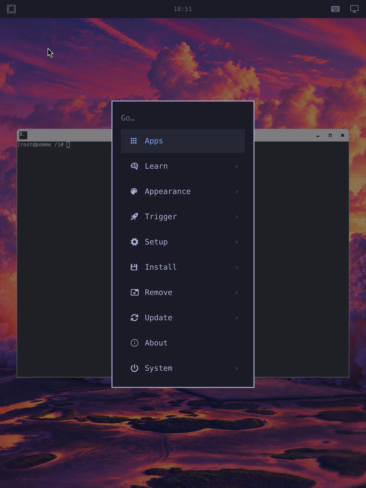

# Omarchy A userspace on an original iPad Air A7

Date: 27 October 2026. This is an experimental hardware report from one physical
device, prepared for the OrchardLinux maintainers.

Omarchy A's published AArch64 userspace rendered its wallpaper, top panel,
terminal, and root menu on an original iPad Air Cellular. The device used a J72
A7 Linux kernel and Hoolock's iBoot/m1n1 boot path. A read-only root image on the
Mac supplied the userspace over USB NBD.

This demonstrates that the desktop can render on this A7 device. It does not
establish an installable J72 release, native touch support, or a usable standalone
tablet. The Omarchy A installer was not used, and the iPad's internal storage was
not partitioned or formatted.



## Hardware and software used

| Component | Observed value |
| --- | --- |
| Device | Original iPad Air Cellular, A1475 |
| Product and board | `iPad4,2`, `J72AP` |
| Processor | Apple A7, `S5L8960`, CPID `0x8960` |
| Installed iOS | 12.5.8 |
| Host | M1 Mac mini, arm64, macOS 27.0.1, USB-A connection |
| Linux | `7.0.12-gdfa4d4208131-dirty`, AArch64, 4 KB pages |
| Device tree | `s5l8960x-j72.dtb` |
| Display | `simpledrm`, 1536 x 2048 at 60 Hz, 2x logical scale |
| Reported memory | `MemTotal: 956340 kB` |
| Desktop | `labwc 0.20.2`, wlroots 0.20.2, Pixman software rendering |
| Root filesystem | Omarchy A v0.1.0 release asset, Arch Linux ARM userspace |

## Sources and integrity

- [Hoolock remote_boot](https://github.com/HoolockLinux/remote_boot) at
  `e254a58b7d7c68c9e34a407a0beb0aab4861a6b6` supplied the iBoot boot procedure and
  its pinned dependencies.
- [Pomme v0.1.0](https://github.com/xenoaitham/pomme/releases/tag/v0.1.0) supplied
  the 4 KB kernel with embedded initramfs, J72 DTB, m1n1 Mach-O, and monitor stub.
  The kernel source pin is Hoolock Linux
  `dfa4d42081312dd34ec33ee8d23174309f683188`. The m1n1 build is based on
  HoolockLinux/m1n1 `bd117d71`. The selected artifacts matched the release hashes.
  Pomme described these artifacts as untested on hardware by its publisher.
- [Omarchy A v0.1.0](https://github.com/OrchardLinux/omarchy-a/releases/tag/v0.1.0)
  supplied `rootfs.tar.zst`. Its SHA-256 matched the published receipt:
  `8ff6897909d2fa3d894f7c87264e223000649f6be513414b9a0fef307adf3e46`.
  The receipt names profile `j71b`, release `preview-40208233937`, and kernel
  `7.3.0-rc1-orchard-j71b`.
- The root archive contained 80,107 entries and 2,738,531,593 bytes of regular-file
  content, matching its receipt. Its userspace was extracted unchanged. Its J71b
  kernel modules and hardware activation services were not used on the A7.

No upstream repository was modified or published during this experiment. Local
scripts assemble and run this combination. This is not an OrchardLinux-supported
device profile.

## Boot path that succeeded

The successful path was:

```text
Mac USB-A
  -> gaster/checkm8 on A7 DFU
  -> patched iBSS and iBEC loaded into RAM
  -> m1n1-idevice Mach-O with monitor stub
  -> J72 DTB and 4 KB Linux kernel with embedded initramfs
  -> USB serial shell and USB NCM network
  -> read-only Mac-hosted ext4 image over NBD
  -> chroot, seatd, labwc/Pixman, foot, and Omarchy A QuickShell
```

Hoolock's `remoteboot.sh prep` downloaded the selected iPad4,2 iOS 12.4 boot
components from Apple's CDN and prepared the J72 cache. `gaster` completed its
RESET, SETUP, SPRAY, and PATCH stages. The boot command sent iBSS, iBEC, the Apple
device tree, the trust cache, and the synthetic restore kernel containing m1n1.

The m1n1 payload used this command line:

```text
console=tty0 loglevel=7 rdinit=/init
```

The USB shell then reported:

```text
Linux pomme 7.0.12-gdfa4d4208131-dirty #1 SMP PREEMPT @1781222400 aarch64 Linux
Apple iPad Air (Cellular)
```

The Linux USB gadget exposed NCM networking and an ACM serial shell. The USB
network also passed a file-transfer test between the Mac and the iPad.

## How the Omarchy userspace was run

The published root archive is about 1.1 GB compressed and expands to 2.74 GB of
regular files. It cannot fit in this device's RAM as a complete temporary root.
Internal storage did not appear in `/sys/block` during the test.

A separate 5 GiB ext4 image was created on the Mac with 4 KB filesystem blocks.
The archive was extracted into that image as root in a local Linux VM to preserve
ownership, permissions, and archive metadata. The image passed `e2fsck -fn` with
exit code 0 after unmounting.

The Mac served the image read-only over the dedicated USB network. Linux mounted
it with `ro,noload`. The image's checksum remained unchanged after the desktop
tests. Runtime files were held in tmpfs.

The chroot needed the following runtime setup:

- Bind mounts for `/dev`, `/proc`, and `/sys`.
- Separate child bind mounts for `/dev/pts` and `/dev/shm`.
- A tmpfs `/dev/shm` and the standard `/dev/fd` and standard-stream links.
- Writable tmpfs mounts for the chroot's `/run` and `/tmp`.
- A private temporary home for first-theme state and QuickShell settings.

`seatd` and `labwc` were started directly. The compositor used an empty config
directory, `WLR_RENDERER=pixman`, `LIBSEAT_BACKEND=seatd`, and
`WLR_LIBINPUT_NO_DEVICES=1`. The project's native-panel scaling helper set scale 2.

The project's first-theme helper populated a temporary home. QuickShell ran
through a private `dbus-run-session`, with the release's Omarchy source directory,
`/usr/local/bin` in `PATH`, and Qt software rendering. The normal PAM/logind
autologin path and J71b systemd hardware services were not started.

Missing `/dev/shm` first prevented keyboard-map allocation. Missing chroot
`/dev/pts` prevented `foot` from opening a PTY. Missing `/dev/fd` broke Bash process
substitution in the plugin scan and theme helpers. Correcting those runtime
mounts and links allowed the desktop and shell to render.

## What was verified on the device

| Feature | Result |
| --- | --- |
| A7 Linux boot through iBoot/m1n1 | Working in RAM |
| Framebuffer console | Visible on the iPad |
| USB serial root shell | Working |
| USB NCM network and file transfer | Working |
| Mac-hosted read-only NBD root | Mounted and executable |
| labwc/Pixman on simpledrm | Working on the physical panel |
| foot terminal | Visible |
| QuickShell wallpaper and top panel | Visible |
| Omarchy root menu | Opened through shell IPC and captured |
| Shell IPC | `omarchy-shell shell ping` returned `ok` |
| Desktop stop and restart | Verified on the live Linux boot |
| Return to normal iOS | Verified during the experiments |

Menu activation was through USB IPC. It was not a physical touchscreen test.

## Hardware and session gaps

- Native touch is absent. Linux registered only `gpio-keys` as an input device.
- No Wi-Fi interface appeared. Network access used the USB link.
- No internal storage block device appeared. No internal-storage installation
  was attempted.
- Graphics used simpledrm and Pixman. GPU acceleration is unverified and was not
  required for this display test.
- Bluetooth, audio, battery reporting, charging policy, suspend, and resume have
  not been validated.
- NetworkManager, UPower, Bluetooth, and PipeWire integration reported missing
  services in this minimal chroot session.
- The desktop ran as root with temporary settings. This was not a normal
  tablet-user login, a long-duration stability test, or a production setup.

## Failed paths and relevant observations

The official macOS checkra1n 0.12.4 build, running through Rosetta, successfully
entered its bundled PongoOS 2.5.1 shell on this A7. A direct `bootl` attempt
accepted the J72 DTB and 4 KB kernel upload but stalled after Pongo's explicit
warning that its direct Linux loader targets iPhone 7 and other A10 devices.

Newer custom Pongo attempts did not establish a usable `bootm` handoff in this
session. Some GUI runs also relaunched without the intended arguments, so those
runs do not establish a precise compatibility diagnosis. The successful route
was Hoolock's iBoot method.

A small writable host NBD image passed a create/unmount/read-back test. Extracting
the full root archive over writable USB NBD later stalled on large write requests.
That partial image was discarded. Populating the image in a local Linux VM and
serving the finished image read-only worked for the desktop test.

## A7 touch investigation

The booted kernel enables `CONFIG_TOUCHSCREEN_APPLE_Z2=y` and `CONFIG_SPI_APPLE=y`.
However, its J72 Linux device tree has no touchscreen or A7 SPI controller node.
The pinned `apple_z2.c` matches Mac Touch Bar devices, not J72.

Apple's generic J72 firmware device tree identifies multitouch on SPI2:

| Property | Firmware-tree observation |
| --- | --- |
| SPI2 MMIO | `0x20a088000`, size `0x4000` |
| SPI2 interrupt | AIC interrupt 138 |
| Touch compatible | `multi-touch,j72` |
| Chip select | GPIO 79 |
| Reset function | GPIO 15 |
| Touch interrupt | GPIO 111 |
| Display sync | GPIO 119 |
| Analog and LDO power | PMU `pmuL` arguments 525 and 529 |
| Touch clock | PWM function |
| Calibration reference | `syscfg/MtCl/0x400` |

These are firmware-tree descriptions, not validated Linux power or SPI sequences.
The existing firmware extractor produced no firmware files from the selected
iOS 12.4 A7 kernel cache. The SPI controller variant, touch firmware format,
power/clock sequencing, and per-device calibration handoff remain open work.

## Suggested next integration boundary

The current evidence supports a separate experimental J72 profile with the
working 4 KB kernel and iBoot/m1n1 path, initially using a host-backed root. The
desktop recipes appear reusable without GPU acceleration. A proper J72 input and
platform runtime still needs development before installer or daily-use claims.

The local launcher source and validation notes accompany this report. Large
root images, Apple firmware, and boot binaries are not included in the small
share bundle. The device owner can supply additional logs or repeat a targeted
RAM-only test.
